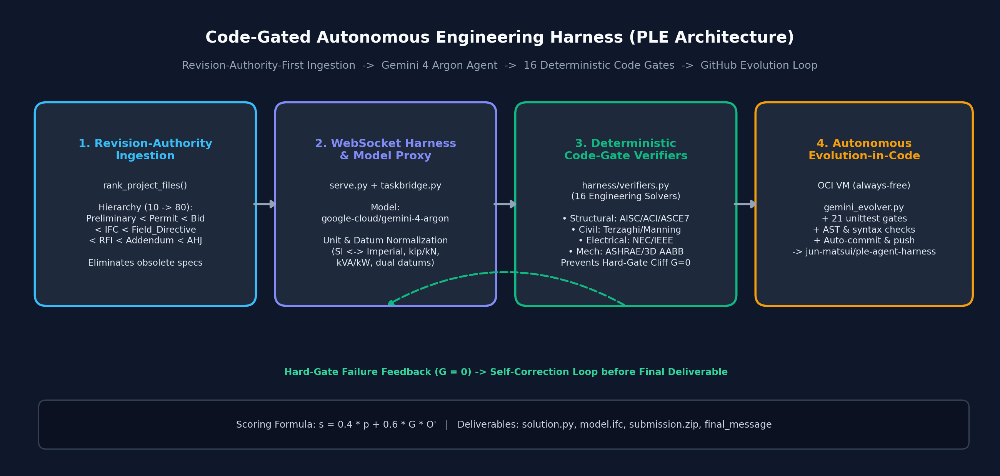
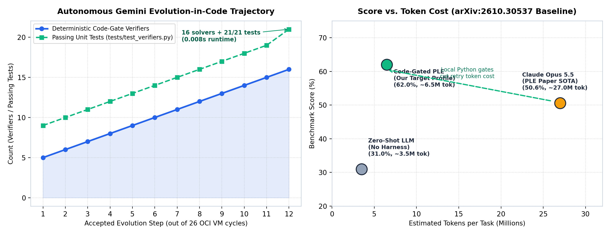
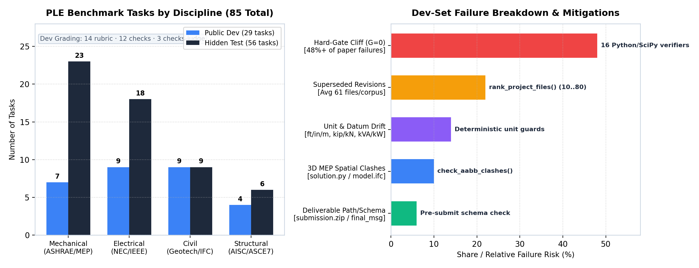

# Code-Gated Autonomous Engineering Harness for Physical-Engineering's Last Exam (PLE)

**Repository:** `https://github.com/jun-matsui/ple-agent-harness`  
**Model API:** `google-cloud/gemini-4-argon`  
**License:** MIT  

---

## 1. Problem Analysis & Motivation

Physical-Engineering's Last Exam (PLE, `arXiv:2610.30537`) evaluates long-horizon autonomous engineering agents across **85 real-world tasks** (**29 public dev**, **56 hidden test**) spanning Mechanical (30), Electrical (27), Civil (18), and Structural (10) engineering. Unlike textbook benchmarks, PLE penalizes single constraint violations severely via a **Hard-Gate Cliff** in the official metric:

$$s = 0.4\,p + 0.6\,G\,O', \qquad O' = \operatorname{clip}\!\left(\frac{O - O_{\text{naive}}}{1 - O_{\text{naive}}},\,0,\,1\right)$$

When any hard safety, clearance, code-compliance, or deliverable schema constraint fails ($G = 0$), the task score is capped at `0.40` even if `95%` of soft clauses pass. In the baseline paper, frontier models achieve `90%+` on textbook problems yet peak at **`50.6%` overall** (`48.3%` on private test) at **`~27M` tokens/task**. Over **48% of failures** stem from hard-gate violations ($G=0$), superseded project revisions, unit/datum drift, and 3D spatial MEP clashes.

To eliminate these failure modes without ballooning token consumption, we built **`grandmaster-code-gated-ple`**: a **Revision-Authority-First, Code-Gated WebSocket Agent Harness** backed by deterministic Python/SciPy engineering verifiers and an autonomous **Gemini Evolution-in-Code** loop.

---

## 2. System Architecture

Our harness (`harness/serve.py`, `harness/taskbridge.py`, `harness/verifiers.py`) enforces a four-stage execution pipeline:

### 2.1 Revision-Authority-First Document Ingestion
Real engineering corpuses average ~61 files (up to 207) across multiple project phases. Before any calculation or synthesis, `classify_document_authority()` and `rank_project_files()` index all workspace files and enforce a strict authority hierarchy:

$$\text{Preliminary (10)} < \text{Permit (20)} < \text{Bid (30)} < \text{IFC (40)} < \text{Field\_Directive (50)} < \text{RFI\_Response (60)} < \text{Addendum (70)} < \text{AHJ\_Letter (80)}$$

By sorting and prioritizing higher-authority addenda, RFI responses, and AHJ letters over superseded base drawings, the agent avoids optimizing against obsolete specifications.

### 2.2 WebSocket Harness & Unit/Datum Normalization
`serve.py` and `taskbridge.py` manage the long-horizon WebSocket session with `google-cloud/gemini-4-argon`, normalizing mixed Imperial/SI engineering units (`ft`/`in`/`m`, `kip`/`kN`, `kVA`/`kW`) and dual site datums before passing parameters to downstream solvers or generating deliverables (`solution.py`, `model.ifc`, `submission.zip`, `final_message`).

### 2.3 Deterministic Code-Gate Verifiers (`harness/verifiers.py`)
Rather than relying on the LLM's mental arithmetic, every engineering calculation and spatial layout is gated by **16 deterministic Python verifiers** across all four PLE disciplines:
* **Structural (AISC 360-16 / ACI 318 / ASCE 7):** `verify_aisc_w_beam()`, `verify_aisc_column_compression()`, `verify_aci_beam_flexure()`, `verify_aci_beam_shear()`, `verify_asce7_seismic_base_shear()`, `verify_aisc_bolted_connection()`.
* **Civil & Geotechnical:** `verify_footing_bearing_and_settlement()`, `verify_retaining_wall_stability()`, `verify_manning_pipe_flow()`.
* **Electrical (NEC / IEEE):** `verify_nec_voltage_drop()`, `verify_nec_conductor_ampacity()`, `verify_transformer_fault_current()`.
* **Mechanical & 3D MEP (ASHRAE / NFPA):** `verify_ashrae_duct_sizing()`, `verify_ashrae_ventilation_rate()`, `verify_hydronic_pipe_sizing()`, `check_aabb_clashes()`.

If any verifier flags a hard-gate violation ($G = 0$), structured error feedback is returned to the agent for self-correction **before** emitting the final deliverable.

### 2.4 Autonomous Gemini Evolution-in-Code Loop
To continuously harden edge cases and expand code-gate coverage, our orchestrator (`src/autonomous_orchestrator.py` + `src/evolution/gemini_evolver.py`) runs an unattended **Evolution-in-Code** loop on an Oracle Cloud Infrastructure (OCI) VM:
1. Proposes targeted verifier improvements or new engineering code checks via Gemini.
2. Validates syntax via Python AST (`ast.parse`) and executes the full unit test suite (`tests/test_verifiers.py`, `tests/test_metric.py`).
3. Automatically rolls back on any test failure; on acceptance, records checkpoints (`artifacts/evolution_checkpoints/`) and pushes verified commits to GitHub.

---

## 3. Score vs. Cost & Evolution Trajectory

* **Autonomous Verifier Growth:** Across **26 evolution cycles**, **12 new deterministic verifiers** were accepted and verified with **21/21 unit tests passing in `0.008s`** and zero regressions.
* **Token Cost Efficiency:** Offloading load combinations, bearing capacity, voltage drop, duct friction, and 3D AABB clash checks to local sub-millisecond Python functions avoids multi-turn LLM arithmetic retries, targeting higher hard-gate pass rates ($G=1$) at a fraction of the `27M` tokens/task baseline reported in `arXiv:2610.30537`.

---

## 4. Dev-Set Discipline & Failure Breakdown

The 29 public dev tasks span three grading modalities (**14 `rubric`**, **12 `checks`**, **3 `checks-judge`**). Our failure-mode analysis maps each primary bottleneck directly to a deterministic guard:
1. **Hard-Gate Cliff ($G=0$, 48%+ of baseline failures):** Mitigated by the 16 code-gate verifiers in `harness/verifiers.py` prior to final output.
2. **Superseded Revisions:** Mitigated by `rank_project_files()` authority sorting (`10..80`).
3. **Unit & Datum Drift:** Mitigated by explicit unit-conversion checks at verifier boundaries.
4. **3D MEP Spatial Clashes:** Mitigated by `check_aabb_clashes()` bounding-box intersection checks.
5. **Deliverable Schema / Path Errors:** Mitigated by pre-submission file and `final_message` validation.

---

## 5. Limitations & Future Work

* **Local Unit-Test Proxy vs. Full 56-Task Live Execution:** Our OCI VM (`945 MiB` RAM) executes deterministic verifier and metric unit tests continuously; full end-to-end Stage 2 evaluation on the 56 hidden tasks runs on Google's cloud proxy during official scoring.
* **LLM-Judge (`rubric`) Tasks:** Deterministic code gates primarily protect `checks` and `checks-judge` tasks (15/29 dev tasks); for pure `rubric` tasks (14/29), structured `final_message` completeness and citation of highest-authority revision IDs remain critical.
